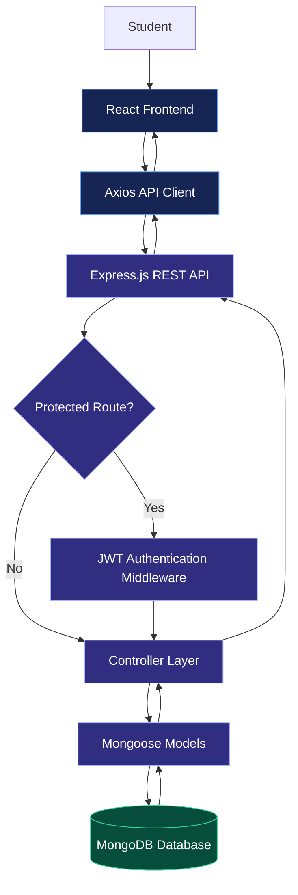

 <div align="center">

  

  <h3>Learn Together. Share Your Skills. Build Your Community.</h3>

  **A full-stack social learning platform where students share knowledge through an immersive, reel-style experience.**

  <p>
    <a href="#features">Explore Features</a> &nbsp; • &nbsp;
    <a href="#architecture">Architecture</a> &nbsp; • &nbsp;
    <a href="#getting-started">Run Locally</a> &nbsp; • &nbsp;
    <a href="#deployment">Deployment</a>
  </p>

  
  
  
  
  

</div>

---

## ✨ Overview

**Student Skill Sharing Platform (SSSP)** is a full-stack social application designed to make peer-to-peer learning more engaging and accessible.

Instead of relying only on traditional posts or discussion forums, SSSP presents student-created skills through a vertically navigable feed inspired by modern short-form content platforms.

Students can showcase what they know, discover new interests, interact with other learners, and build a community around shared skills.

> **The idea:** Turn everyday student knowledge into something discoverable, interactive, and shareable.

## 🚀 Features

<table>
  <tr>
    <td width="50%">
      <h3>🎬 Immersive Skill Feed</h3>
      Browse image and video skill posts through a vertically scrolling, snap-based interface.
    </td>
    <td width="50%">
      <h3>❤️ Social Interactions</h3>
      Like posts, comment on content, and follow other students to build connections.
    </td>
  </tr>
  <tr>
    <td width="50%">
      <h3>🔎 Explore & Discover</h3>
      Search for skills and explore categories such as coding, music, art, and creativity.
    </td>
    <td width="50%">
      <h3>👤 Student Profiles</h3>
      View student bios, shared skills, liked posts, and follower/following information.
    </td>
  </tr>
  <tr>
    <td width="50%">
      <h3>⚡ Responsive Interactions</h3>
      Use React state and Context API to reflect supported social actions immediately in the interface.
    </td>
    <td width="50%">
      <h3>🌙 Modern User Experience</h3>
      Explore a responsive interface with glassmorphism-inspired styling and dark/light theme support.
    </td>
  </tr>
</table>

## 🎯 Why SSSP?

Traditional learning platforms often focus on courses, lengthy tutorials, or structured lessons. SSSP explores a more social approach: students can share smaller pieces of knowledge, learn from peers, and discover skills outside their regular coursework.

- **For learners:** Discover useful skills and learn from other students.
- **For creators:** Showcase knowledge, personal projects, and creative abilities.
- **For communities:** Encourage collaboration and knowledge exchange among students.

## 🛠️ Tech Stack

| Layer | Technologies | Purpose |
|---|---|---|
| Frontend | React.js, CSS3 | Interactive and responsive user interface |
| Animation | Framer Motion | Smooth interface animations |
| Icons | Lucide React | Consistent interface icons |
| State Management | React Context API | Shared authentication and application state |
| API Communication | Axios | Centralized communication with the backend |
| Backend | Node.js, Express.js | REST API and application logic |
| Database | MongoDB, Mongoose | Persistent storage and data modelling |
| Authentication | JSON Web Tokens (JWT) | Authenticated access to protected operations |

## 🏗️ Architecture

SSSP follows a client-server architecture. The React frontend communicates with the Express backend, which processes requests, applies authentication checks where required, and interacts with MongoDB through Mongoose.



### 🔄 How the Application Works

1. **Authentication:** Students register or log in to access account-specific functionality.
2. **Content delivery:** The frontend requests skill posts from the backend API.
3. **Data processing:** Express controllers process requests and use Mongoose models to work with MongoDB.
4. **Social interactions:** Authenticated users can perform supported actions such as liking, commenting, and following.
5. **Interface updates:** React updates the relevant interface components to reflect interaction results.
6. **Personal discovery:** Students can explore skill categories and view profile information.

## 📂 Project Structure

```text
SSSP/
│
├── frontend/
│   └── src/
│       ├── components/
│       │   └── SkillReel.jsx
│       ├── context/
│       │   └── AuthContext.jsx
│       ├── pages/
│       │   ├── Home.jsx
│       │   ├── Profile.jsx
│       │   └── Trending.jsx
│       ├── App.jsx
│       ├── api.js
│       └── index.css
│
├── backend/
│   ├── models/
│   │   ├── Skill.js
│   │   └── User.js
│   ├── controllers/
│   │   ├── userController.js
│   │   └── skillController.js
│   ├── middleware/
│   │   └── authMiddleware.js
│   ├── server.js
│   └── .env
│
└── README.md
```


## 🔐 Authentication & Security

The application uses JWT-based authentication to support authenticated user interactions.

Security considerations include:

- Protecting routes that require authentication with JWT verification.
- Keeping database connection strings and authentication secrets in environment variables.
- Using HTTP-only cookies for tokens where supported by the implementation.
- Configuring cross-origin requests appropriately between the deployed frontend and backend.
- Never committing `.env` files, credentials, or real student information to GitHub.

**Note:** Cookie settings, password hashing, and production CORS configuration should match the actual implementation before the application is deployed.

## ⚙️ Getting Started

Follow these steps to run the application locally.

### Prerequisites

Install the following before starting:

- [Node.js and npm](https://nodejs.org/)
- A [MongoDB Atlas](https://www.mongodb.com/atlas) database or a local MongoDB instance
- Git

### 1. Clone the Repository

```bash
git clone <YOUR_GITHUB_REPOSITORY_URL>
cd <YOUR_REPOSITORY_FOLDER>
```

Replace the placeholders with your repository URL and folder name.

### 2. Install Backend Dependencies

Open a terminal from the project root:

```bash
cd backend
npm install
```

### 3. Configure Environment Variables

Create a `.env` file inside the `backend` directory:

```env
PORT=5001
MONGO_URI=your_mongodb_connection_string
JWT_SECRET=your_long_random_secret
```

Replace the example values with your own configuration. Do not publish your actual secrets.

### 4. Start the Backend

From the `backend` directory, run:

```bash
npm start
```

If the backend does not define a `start` script in `package.json`, use the command configured for your project, such as `node server.js`.

### 5. Install Frontend Dependencies

Open a **second terminal** from the project root:

```bash
cd frontend
npm install
```

Configure the backend API URL using the variable expected by your `src/api.js` file. For example, if it reads `REACT_APP_API_URL`, create `frontend/.env` containing:

```env
REACT_APP_API_URL=http://localhost:5001
```

Restart the frontend development server after changing environment variables.

### 6. Start the Frontend

```bash
npm start
```

Open the local URL displayed in your terminal, commonly `http://localhost:3000` for a Create React App setup.

## 🌍 Deployment

The application can be deployed using a hosted MongoDB database, a backend hosting service, and a frontend hosting service.

### Step 1 — Database: MongoDB Atlas

1. Create a cluster in MongoDB Atlas.
2. Configure database access and network permissions.
3. Obtain the database connection string.
4. Set it as `MONGO_URI` in the backend hosting dashboard.

### Step 2 — Backend: Render

1. Push the project to GitHub.
2. Create a new Web Service on [Render](https://render.com/).
3. Select your repository and set the backend directory as the root directory when prompted.
4. Configure the build and start commands according to your backend setup.

Typical commands when the service root is `backend`:

```bash
Build Command: npm install
Start Command: npm start
```

Add the required environment variables in the hosting dashboard:

```env
MONGO_URI=your_mongodb_connection_string
JWT_SECRET=your_long_random_secret
```

Ensure the backend listens on the port supplied by the hosting provider, for example through `process.env.PORT || 5001`.

### Step 3 — Frontend: Vercel

1. Import your GitHub repository into [Vercel](https://vercel.com/).
2. Set the frontend directory as the project root.
3. Configure the build command and output directory to match your frontend setup.

Typical settings for Create React App:

```text
Build Command: npm run build
Output Directory: build
```

Configure the frontend environment variable with your deployed backend URL:

```env
REACT_APP_API_URL=https://your-backend-service-url
```

Before deployment, verify that the backend accepts requests from your frontend domain and that cookie credentials are configured correctly if authentication uses cookies.

## 🧠 Key Engineering Concepts Demonstrated

This project brings together several concepts relevant to full-stack software development:

- Component-based UI development with React.
- Client-side routing and protected application access.
- Centralized API communication using Axios.
- REST API development with Node.js and Express.
- Database modelling with MongoDB and Mongoose.
- Authentication middleware and protected endpoints.
- Social relationship and interaction logic.
- Responsive CSS design, theme variables, and animation.
- Separation of application responsibilities across frontend, controllers, models, and middleware.

## 🔮 Potential Future Enhancements

- Personalized skill recommendations.
- Bookmarks and saved skill collections.
- Notifications for comments, likes, and new followers.
- Content reporting and moderation tools.
- Student verification and institution-based communities.
- Analytics for creators to understand engagement.
- Automated testing and continuous integration.


## 👩‍💻 About the Project

SSSP was developed to explore how a social-media-style experience can make student knowledge sharing more engaging. The project combines an interactive React interface with a Node.js and Express backend, database persistence, and authentication.

**Interested in the implementation?** Explore the source code, review the application structure, and follow the setup steps to run it locally.

---

<div align="center">

  **Student Skill Sharing Platform**

  *Share knowledge. Discover talent. Learn together.*

  <sub>Built with React.js, Node.js, Express.js, and MongoDB.</sub>

</div>


